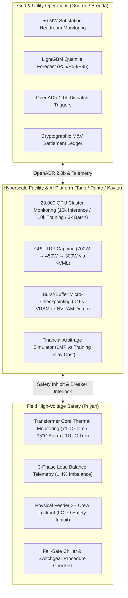
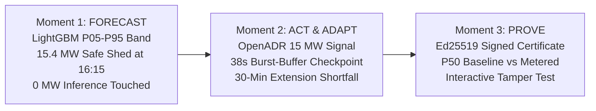

# GridSync: AI Demand Orchestrator & Micro-Checkpointing Console

> **Bearcat — Powering the AI Buildout (BE Smart) Hackathon**  
> *Memphis AI Campus · 56 MW Substation Interconnection · 29,000 GPUs*

[](https://vitejs.dev/)
[](https://react.dev/)
[](https://www.typescriptlang.org/)
[](https://tailwindcss.com/)
[](LICENSE)

---

## Executive Summary

Electric utilities currently tell hyperscale AI developers that interconnecting 50 to 100 MW clusters will take 5 to 7 years because peak grid stress risks catastrophic regional brownouts. 

**GridSync eliminates the interconnection bottleneck by answering one fundamental question:**
> *"How many megawatts can an AI data center safely shed, for how long, at what operational cost — without damaging multi-million dollar training runs, without touching revenue-generating inference, and can we cryptographically prove it to the utility?"*

GridSync bridges the communication and control gap between electric utility grid directors, data center infrastructure teams, and field high-voltage electricians through real-time demand response orchestration, physics-grounded GPU TDP capping, sub-45s burst-buffer micro-checkpointing, and Ed25519 cryptographic Measurement & Verification (M&V) certificates.

---

## System Architecture & Personas

GridSync is built with a role-tailored multi-persona architecture designed to an industrial **"Apple Settings × Notion × ChatGPT"** aesthetic (clean light panels, high-contrast typography, zero neon AI slop).



### 1. Grid & Utility Interconnection Operations (Brenda & Gudrun)
- **Real-Time Substation Telemetry:** Live monitoring of 56 MW nameplate capacity, 11.6 MW operational headroom, and 44.2 MW forecast peak.
- **Quantile Demand Forecasting:** 24-hour LightGBM model outputting P05, P50, and P95 uncertainty bands with an MAE of `0.42 MW` (compared against naive `1.31 MW` last-week benchmark).
- **OpenADR 2.0b Virtual Top Node (VTN):** Ingests standardized automated demand response signals (e.g. 15 MW for 2 hours).
- **Settlement Ledger:** Tracks historical curtailment events with verified MW delivery, compliance percentage, and signed verification records.

### 2. Hyperscale Facility & AI Platform Control (Tariq, Dante, & Kavita)
- **Workload Tier Isolation:** Protects 16,000 inference GPUs (`20.4 MW`) with zero curtailment; schedules flexible load across 10,000 training GPUs and 3,000 batch Slurm jobs.
- **Physics-Grounded TDP Scaling:**
  $$\text{Throughput} \propto \text{Power}^{0.6}$$
  - **700W (Base):** 100% throughput, $0 delay cost.
  - **450W (Curtailment):** 77% throughput (23% slowdown), saves 3.0 MW at meter ($11,644 delay cost).
  - **300W (Deep Cap):** 60% throughput (40% slowdown), saves 4.8 MW at meter ($20,250 delay cost).
- **Burst-Buffer Micro-Checkpointing:** Node-local NVRAM staging writes 2.4 TB training state at 60 GB/s in <45 seconds, preventing checkpoint corruption before power ramp-down.
- **Financial Arbitrage Simulator:** Real-time Locational Marginal Price (LMP) slider ($40 to $1,000/MWh) calculating net arbitrage value:
  $$\text{Net Value} = \text{Avoided Energy Cost} + \text{DR Capacity Payment} - \text{Training Delay Cost}$$

### 3. Technician Field View (Priyah)
- **Transformer Thermal Gauges:** Real-time semicircle temperature dial monitoring transformer core temperature against 95°C alarm and 110°C trip thresholds.
- **3-Phase Imbalance Telemetry:** Substation load balancing across Phase A, Phase B, and Phase C (maintaining <5% IEEE standard).
- **Physical Lockout/Tagout (LOTO):** Engaging the Feeder 2B lockout immediately flags levers across the application as *Blocked — crew lockout* and inhibits automated remote switching.
- **7-Step Procedure Checklist:** Mandatory human-in-the-loop transfer checklist for chiller loops and high-voltage breaker sequencing.

---

## GridSync Judges Demo Playbook

Follow this exact walkthrough when presenting GridSync to hackathon judges.

### The 30-Second Elevator Pitch
> *"Utilities are pausing AI data center grid connections because uncoordinated peak power spikes threaten grid stability.  
> GridSync is the mission-critical orchestration bridge: using quantile forecasting, sub-45-second burst-buffer checkpointing, and dynamic GPU power capping, we guarantee utilities verified load reduction during emergency grid peaks — while guaranteeing AI operators that revenue inference workloads are never touched and training jobs never crash."*

---

### The Three Demo Moments



#### Moment 1: FORECAST — "Know Before You Owe"
1. **Navigate to:** **Utility** persona (top bar) → **Overview** tab.
2. **Show the Metrics:**
   - **Substation Headroom:** `11.6 MW` (of 56 MW capacity)
   - **Forecast Peak Today:** `44.2 MW` at `4:15 PM`
   - **Safe Shed at P95:** `15.4 MW` for 2 hours · *inference protected*
   - **Forecast Error (MAE):** `0.42 MW` (vs `1.31 MW` baseline)
3. **Show the Chart:** Point out the LightGBM P05–P95 uncertainty band and the dashed peak marker at 16:15.
4. **What to Say:**
   > *"We don't treat data center load as an unpredictable black box. Using quantile LightGBM models, we provide the utility with a mathematically guaranteed P95 commitment: we can safely shed 15.4 MW for 2 hours with 0 MW of inference touched."*

---

#### Moment 2: ACT & ADAPT — "The Emergency Sequence with an Unexpected Extension"
1. **Navigate to:** Click the blue header button **`Simulate 15 MW dispatch`** (or **Load-shed event** in the sidebar).
2. **Execute the Sequence:**
   - **Step 1 (Signal Ingested):** Ingests simulated OpenADR 2.0b signal from MLGW.
   - **Step 2 (Plan and Approve):** Point out the human-in-the-loop approval dialog showing **$15,959 operational cost** vs **$210,000/month avoided peak demand charge**. Click **`Approve plan`**.
   - **Step 3 (Checkpoint Staged):** Watch the animated progress bar dump 2.4 TB training state from VRAM to NVRAM burst buffers in 38 seconds.
   - **Steps 4 & 5 (Levers Dispatched):** Pre-cool chillers to 42°F (4 MW), dispatch battery (5 MW, 40% reserved), cap training GPUs 700W → 450W (3 MW), and drain Slurm batch jobs (3 MW).
   - **Step 6 (Target Achieved):** Delivered load reaches **15.2 MW**.
3. **The Real-World Failure Mode (Extension Notice):**
   - An orange alert banner suddenly appears:  
     `GRID EXTENSION NOTICE: MLGW extended the event by 30 minutes.`
   - Point out the shortfall: *"Battery and thermal storage now only cover 14.8 MW — we are short 0.2 MW."*
   - Show the automated AI proposal: *"Deepen training cap 450W → 300W (+1.8 MW at meter, cost $2,071, slows training ~40% for the final 30m without dropping jobs)."*
   - Click **`Approve deeper cap`**.
   - Watch the delivered telemetry rise to **16.6 MW** (98% compliance).
4. **What to Say:**
   > *"In real electrical grids, things go wrong. Mid-event, the utility prolonged the dispatch by 30 minutes. Rather than suffering an SLA violation or tripping regional feeders, GridSync calculated the exact GPU power physics and deepened the cap to 300W to maintain compliance without dropping any training jobs."*

---

#### Moment 3: PROVE — "Cryptographic Measurement & Verification"
1. **Navigate to:** Click **Certificates** in sidebar (or view Step 7 of the event).
2. **Show Certificate `MV-2026-1120-01`:**
   - Verified reduction: **15.3 MW** average.
   - Energy shed: **38.2 MWh**.
   - Compliance: **98%**.
   - Inference curtailed: **0 MW** (Protected Tier).
   - SLA breaches: **0**.
   - Ed25519 signature and SHA-256 digest (`9f2c84d1...`).
3. **Click `Verify certificate`:**
   - Shows green badge: `Valid — signature and hash match`.
4. **Click `Tamper test`:**
   - Status instantly turns bright red: `Invalid — hash mismatch`! Click `Restore original` to revert.
5. **What to Say:**
   > *"Instead of utilities and data centers spending weeks arguing over spreadsheets, GridSync generates an immutable, Ed25519-signed certificate comparing the counterfactual P50 baseline against metered telemetry. If anyone alters the numbers, the cryptographic hash fails immediately."*

---

#### Bonus Moment: Field Technician Safety Lockout
1. **Switch Persona:** Select **Field technician** in the top bar.
2. **Show Safety Gauges:** Transformer core reading (`71°C`), alarm (`95°C`), and 3-phase balance (`1.4%`).
3. **Engage Lockout:** Click **`Engage lockout (Feeder 2B)`**.
4. **Show Campus-Wide Inhibit:** An orange warning banner appears across the app:  
   `SAFETY LOCKOUT ENGAGED: Automated switching on Feeder 2B is blocked (Priyah, Lead Tech).`
5. **What to Say:**
   > *"Software automation cannot ignore physical human safety. If an electrician is servicing switchgear, automated algorithms are locked out. GridSync connects digital AI orchestration to electrical reality."*

---

### 90-Second Rapid Pitch Script

| Time | Screen | Action & Spoken Script |
|---|---|---|
| **0:00–0:15** | **Utility Overview** | *"Judges, AI power demand is colliding with grid reality. GridSync bridges the gap between hyperscale data center operators and electric utilities through real-time demand orchestration."* |
| **0:15–0:35** | **Forecast Chart** | *"Here in our Utility View, our LightGBM quantile model forecasts a 44.2 MW peak today at 4:15 PM with an error of just 0.42 MW. We guarantee the utility 15.4 MW of safe shed at P95 without ever touching our 16,000 inference GPUs."* |
| **0:35–1:05** | **Emergency Event** | *Click "Simulate 15 MW dispatch" → "Approve plan". Watch 38s micro-checkpointing → GPU power cap. When the 30-min extension alert appears, click "Approve deeper cap".* |
| **1:05–1:20** | **Certificates** | *Click "Certificates" → Click "Verify" (green valid) → Click "Tamper test" (red hash mismatch).* |
| **1:20–1:30** | **Field Technician** | *Switch to "Field technician" → Click "Engage lockout (Feeder 2B)" to show physical crew safety.* |

---

## Quickstart & Local Installation

### Prerequisites
- Node.js 18+ or 20+
- npm or pnpm

### Setup
```bash
# Clone repository
git clone https://github.com/Lincolntinodaishe/Bearcat-Powering-the-AI-Buildout-BE-Smart.git
cd Bearcat-Powering-the-AI-Buildout-BE-Smart

# Checkout feature branch
git checkout moubarak-foundation

# Install dependencies
npm install

# Start local development server
npm run dev
```

Visit `http://localhost:5174/` (or the port output by Vite) in your browser.

### Build & Verification
```bash
# Type check and build bundle
npm run build
```

---

## Technology Stack

- **Runtime & Bundler:** Vite 6, React 19, TypeScript
- **Styling & Tokens:** Tailwind CSS v4 (`@theme` tokens for `page`, `panel`, `line`, `ink`, `accent`, `ok`, `watch`, `danger`)
- **Data Visualization:** Recharts (Banded Area Charts, Stacked Power Bars, Phase Imbalance, Telemetry Verification Curves)
- **Icons:** Lucide React
- **Protocol Standards:** OpenADR 2.0b telemetry schemas, Ed25519 signature standards, SHA-256 ledger integrity

---

## Team & Credits

- **Moubarak Ali-Kparah** — Full-Stack Systems, Frontend Architecture & Demand Orchestration
- **Lincoln Tinodaishe** — Power Systems Modeling & Repository Lead
- Built for the **Bearcat — Powering the AI Buildout (BE Smart) Hackathon**.
